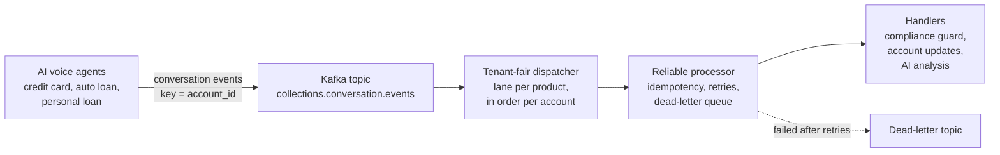

# tenant-fair-streaming

Tenant-fair Kafka event processing for a bank's **AI debt-recovery voice agents**.

Each loan product (credit card, auto loan, personal loan) runs its own AI agent that calls
its own past-due customers. Every conversation turn goes to **one shared Kafka topic**,
because all products share one platform for compliance, account updates and AI analysis.

**The problem:** when one product runs a large campaign, its events fill the shared
consumer, and urgent events from the other products (for example *"stop calling me"*)
wait behind them. This repo shows a dispatcher that isolates products while keeping
each customer's events in order.

Full problem statement and diagrams: [docs/problem-statement.md](docs/problem-statement.md)

## Architecture



## Quick start (no Kafka needed)

```bash
python3 -m venv .venv && source .venv/bin/activate
make install
make test   # 27 tests, about 5 seconds
make demo   # compares three dispatch strategies on the same campaign burst
```

`make demo` output, abbreviated (2,000 events; credit card arrives as one burst, the
other products arrive steadily):

| Strategy | Auto loan p99 | Personal loan p99 | Ordering errors |
|---|---|---|---|
| Sequential (one shared consumer) | 4.7 s | 4.7 s | 0 |
| Unordered pool ("just add workers") | 1.1 s | 1.2 s | 126 |
| **Tenant-fair** | **13 ms** | **13 ms** | **0** |

- **Sequential** keeps order, but every product waits behind the credit card burst.
- **Unordered pool** is faster, but processes customers' events out of order.
- **Tenant-fair** gets both: other products are not delayed, and order is kept.

## Run on Kafka

Requires Docker.

```bash
make kafka-up                                   # single-node Kafka (KRaft) + topics
make consume STRATEGY=tenant-fair RUN_SECONDS=90  # terminal 1: start the consumer first
make produce RUN_SECONDS=60                     # terminal 2: publish simulated calls
make kafka-down
```

`STRATEGY` can be `sequential`, `unordered-pool` or `tenant-fair`.

## How it works

| Concern | Where | How |
|---|---|---|
| Product isolation | `dispatchers/tenant_fair.py` | One bounded lane per product; workers pick lanes round-robin |
| Order per customer | `dispatchers/product_lane.py` | Events queue per account; an account is handed to only one worker at a time, different accounts run in parallel |
| No double-apply | `processing.py`, `idempotency.py` | `event_id` is checked first and recorded only **after** success |
| Failing events | `processing.py`, `dead_letter.py` | Bounded retries, then the dead-letter topic; a worker never dies |
| No lost events | `kafka_adapter/offset_tracker.py` | Auto-commit is off; Kafka offsets are committed only up to the lowest event still in progress |
| Backpressure | `dispatchers/tenant_fair.py` | A full lane makes intake wait, so memory stays bounded |

Design patterns used: **Bulkhead** (a lane per product), **Idempotent Consumer**,
**Dead Letter Channel**, **Strategy** (interchangeable dispatchers behind one
interface), **Ports and Adapters** (the idempotency store, dead-letter sink and event
source are interfaces with in-memory and Kafka implementations), and a **Composition
Root** (`pipeline.py`) that wires them together.

## Project layout

```
tenant_fair_streaming/
  events.py            conversation event model
  simulator.py         simulated AI agent calls per product campaign
  arrivals.py          arrival patterns (campaign burst vs steady traffic)
  dispatchers/         sequential, unordered pool, tenant-fair
  processing.py        idempotency + retries + dead-letter
  handlers.py          compliance guard, account updates, simulated AI analysis
  kafka_adapter/       Kafka source, publisher, dead-letter sink, offset tracking
  pipeline.py          composition root
  cli.py               demo / produce / consume commands
tests/                 unit and behaviour tests
docs/                  problem statement and design
```

## Trade-offs and production gaps

- **Delivery is at-least-once, not exactly-once.** Offsets are committed after
  processing, so a crash replays some events; the idempotency check absorbs the replays.
- **A full lane pauses all intake.** Kafka partitions mix products, so the consumer
  cannot pause only one product. Lanes are sized well above normal bursts. If one
  product keeps saturating its lane, give it its own topic.
- **In-memory state.** The idempotency store and account state are in memory; production
  would use Redis or DynamoDB (with a TTL) and the account system of record.
- **Simulated work.** Downstream calls (LLM analysis, CRM updates) are simulated with
  `sleep`, and the voice agent is simulated by `simulator.py`.
- **Single consumer process.** Scaling out means more consumers in the same group; each
  one runs this dispatcher over the partitions it is assigned. Rebalance handling
  (draining and committing when a partition is revoked) is not implemented yet.
