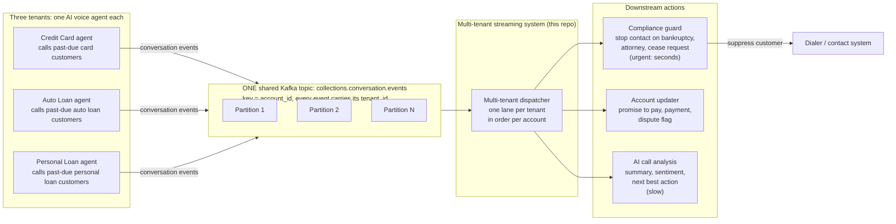
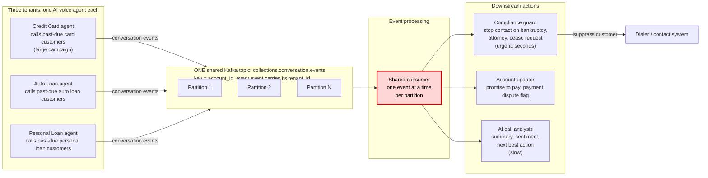
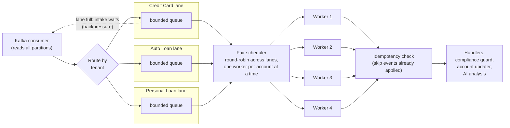

# Multi-Tenant Streaming System

[](https://github.com/eresh-thekbr/multi-tenant-streaming/actions/workflows/ci.yml)

A Kafka consumer that lets several tenants share one event stream without slowing each
other down, while keeping every customer's events in order and never applying an event twice.

## 1. Architecture

A bank runs one AI voice agent per lending tenant: **Credit Card**, **Auto Loan** and
**Personal Loan**. Each agent calls only its own past-due customers and publishes every
conversation turn to **one shared Kafka topic**, which feeds compliance, account
updates and AI call analysis.



There is **one** events topic, not one per tenant: the tenants share an event format and
the same downstream services, so adding a tenant needs no new topic or deployment. The
key is `account_id`, so each customer's events stay in one partition, in order.

### One call and the events it sends to Kafka

Every turn of the conversation is published to Kafka. When the AI recognises a business
intent (a promise to pay, a dispute), it also publishes a business event.


## 2. The problem

A standard consumer handles each partition **one event at a time**. When Credit Card
launches a large calling campaign, its events fill every partition, and **urgent events
from the other tenants wait behind them**.



*Credit Card campaign traffic fills the red box; Auto Loan and Personal Loan events wait there.*

**Impact.** An Auto Loan customer says *"stop calling me"*. The "do not contact" flag is
set only after the Credit Card backlog clears, so the dialer calls the customer again,
a **compliance violation the Auto Loan team didn't cause**.

Measured with `make benchmark` (2,000 events; Credit Card arrives as one burst, the
other tenants arrive steadily):

| Tenant | p99 wait, shared consumer | p99 wait, multi-tenant consumer |
|---|---|---|
| Credit Card (campaign) | 4.6 s | 1.3 s |
| Auto Loan | **4.7 s** | **14 ms** |
| Personal Loan | **4.7 s** | **18 ms** |

Simply adding workers is not enough: a plain worker pool cut the wait but applied
**131 events out of order** (for example, a dispute processed before the promise to pay
that came before it).

## 3. The design that solves it

End-to-end path of one event, from the voice agent to the committed Kafka offset:



Inside the consumer:



| Requirement | How the design meets it |
|---|---|
| One tenant cannot delay another | A lane per tenant and a round-robin scheduler |
| Each customer's events stay in order | Only one worker handles a given account at a time |
| A busy tenant cannot exhaust memory | Bounded lane; when it is full, intake waits until it drains |
| No duplicate promises or payments | `event_id` is recorded only after successful processing |
| A bad event does not stop the system | Retried, then sent to the dead-letter topic |
| No lost events | Offsets are committed only up to the oldest event still in progress |

## 4. Run it

```bash
make install && make test     # 36 tests
make benchmark                # the comparison above, no Kafka needed
make up && make load          # Kafka + the consumer in Docker, then 60 s of traffic
make logs                     # per-tenant progress every 30 s
make down
```

Step-by-step instructions, configuration and troubleshooting: [EXECUTION.md](EXECUTION.md).

## 5. Project layout

```
multi_tenant_streaming/
  domain/          conversation event and account state
  dispatch/        tenant lanes and the multi-tenant dispatcher
  processing/      idempotency, retries, dead-letter, event handler
  messaging/       Kafka consumer, producer, offset tracking
  observability/   per-tenant metrics and logging
  benchmark/       load generator and baseline strategies for comparison
  config.py        settings from environment variables
  cli.py           serve, benchmark, consume, generate-load
tests/
```

## 6. Design decisions and limits

- **One topic, not one per tenant.** A tenant that permanently dominates traffic, or
  needs its own retention or SLA, should get its own topic.
- **At-least-once delivery.** A crash can replay events; the idempotency check absorbs
  them.
- **A full lane pauses all intake.** Partitions mix tenants, so the consumer cannot
  pause just one. Lanes are sized well above normal bursts.
- **In-memory idempotency store.** It is behind an interface; production would back it
  with Redis or DynamoDB with a TTL.
- **Rebalancing is not handled yet.** Scaling to several consumer instances needs a
  commit on partition revoke.
