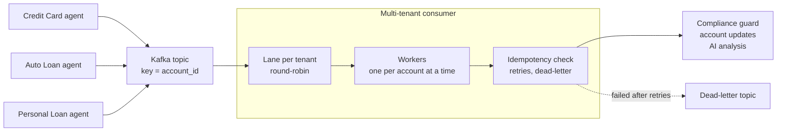

# Multi-Tenant Streaming System

A Kafka consumer that lets several tenants share one event stream without slowing each
other down, while keeping every customer's events in order and never applying an event twice.

## Why it's needed

A bank runs an AI voice agent per lending tenant (**Credit Card**, **Auto Loan**,
**Personal Loan**). Each agent calls its own past-due customers and publishes every
conversation turn to **one shared Kafka topic**, which feeds compliance, account
updates and AI call analysis.

A standard consumer handles each partition one event at a time. When Credit Card
launches a large calling campaign, its events fill every partition, and Auto Loan's
urgent event (*"stop calling me"*) waits behind thousands of them. The "do not contact"
flag arrives late, the customer is called again, and **the bank has a compliance
violation it didn't cause**.

Measured with `make benchmark` (2,000 events; Credit Card arrives as one burst, the
other tenants arrive steadily):

| Tenant | p99 wait, shared consumer | p99 wait, multi-tenant consumer |
|---|---|---|
| Credit Card (campaign) | 4.6 s | 1.3 s |
| Auto Loan | **4.7 s** | **14 ms** |
| Personal Loan | **4.7 s** | **18 ms** |

Simply adding workers is not enough: a plain worker pool cut the wait but applied
**131 events out of order** (for example, a dispute processed before the promise to pay
that came before it).

## How multi-tenancy solves it



- **A lane per tenant.** Each tenant gets its own bounded queue and workers take
  turns across tenants, so a busy tenant only slows itself down.
- **In order per account.** An account is handled by one worker at a time; different
  accounts run in parallel.
- **Never applied twice.** Each `event_id` is recorded only after it succeeds, so
  redelivered events are skipped and failed ones are retried, then dead-lettered.
- **No lost events.** Kafka offsets are committed only up to the oldest event still in
  progress, and a stop signal drains in-flight work before the final commit.

## Run it

```bash
make install && make test     # 36 tests
make benchmark                # the comparison above, no Kafka needed
make up && make load          # Kafka + the consumer in Docker, then 60 s of traffic
make logs                     # per-tenant progress every 30 s
make down
```

Step-by-step instructions, configuration and troubleshooting: [EXECUTION.md](EXECUTION.md).

## Project layout

```
multi_tenant_streaming/
  domain/          conversation event and account state
  dispatch/        tenant lanes and the multi-tenant dispatcher
  processing/      idempotency, retries, dead-letter, event handler
  messaging/       Kafka consumer, producer, offset tracking
  observability/   per-tenant metrics and logging
  benchmark/       load generator and baseline strategies for comparison
  config.py        settings from environment variables
  cli.py           serve, benchmark, consume, generate-load
tests/
```

## Design decisions and limits

- **One topic, not one per tenant.** Tenants share an event format and downstream
  services, so adding a tenant needs no new topic or deployment. A tenant that
  permanently dominates traffic should get its own topic.
- **At-least-once delivery.** A crash can replay events; the idempotency check absorbs
  them.
- **A full lane pauses all intake.** Partitions mix tenants, so the consumer cannot
  pause just one. Lanes are sized well above normal bursts.
- **In-memory idempotency store.** It is behind an interface; production would back it
  with Redis or DynamoDB with a TTL.
- **Rebalancing is not handled yet.** Scaling to several consumer instances needs a
  commit on partition revoke.
