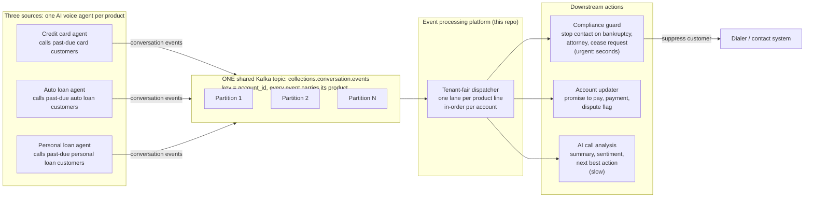
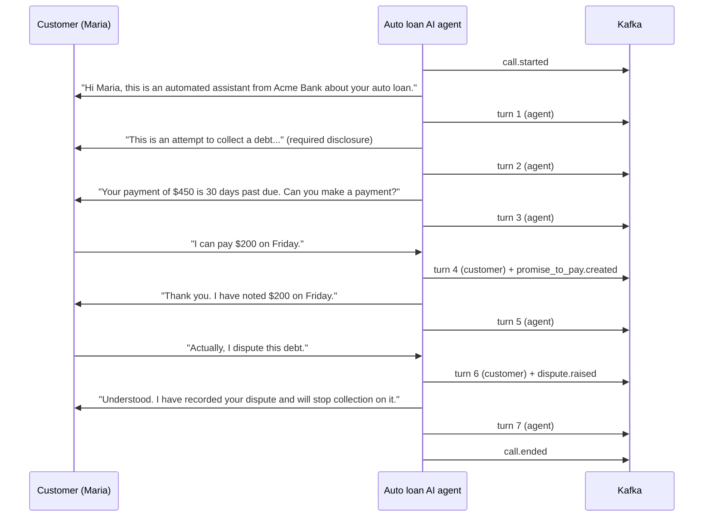
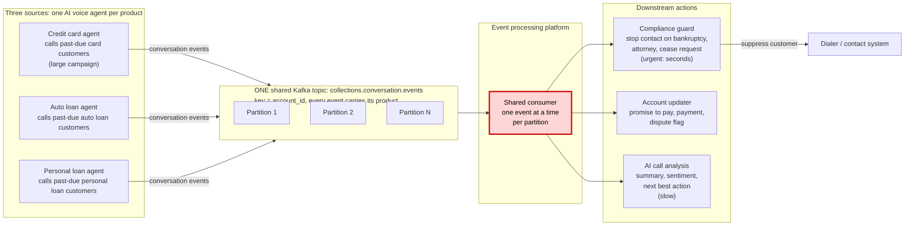
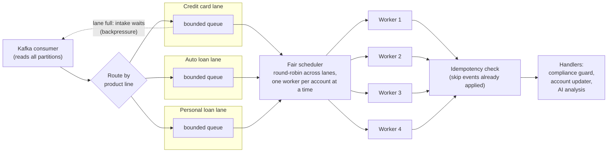

# Multi-tenant streaming: tenant-fair Kafka processing

Several product lines of a bank share one Kafka event pipeline for their **AI
debt-recovery voice agents**. This repo shows how to stop one product line's traffic
from delaying the others, while keeping every customer's events in order and never
applying the same event twice.

## 1. Context

A US bank uses **AI voice agents** to talk to customers about overdue balances (debt
recovery / collections). Each product line has its own agent, and an agent only calls
customers whose accounts are **past due**; it never contacts customers who are current.
One shared platform serves all the **product lines**:

| Product line (tenant) | Typical traffic |
|---|---|
| Credit cards | Very high volume, large outbound calling campaigns |
| Auto loans | Medium volume |
| Personal loans | Low volume |

While an agent talks to a customer, the call produces **events** (what was said,
what the customer intends, promises to pay, payments). These events go to **Kafka**
so that other systems can react to them in near real time.

### What is a "tenant" here?

A **tenant** is a group that **shares a system** with other groups but must be
**treated separately**, like apartments in one building. Here the shared system is
the event pipeline, and the tenants are the product lines. Because all product lines
flow through the same pipeline, the system is **multi-tenant**.

## 2. High-level architecture



Note: the live conversation itself (speech in, AI reply out) does **not** go through
Kafka. Kafka carries **what happened in the call** to the systems that must act on it.

### One topic, three sources

There is **one** events topic, not one per product. The three product agents are
three independent sources writing to it. Every event carries its `product`, and the
key is `account_id`, so all of one customer's events land in the same partition, in
order. The consumer then separates the products again and handles them fairly (see
section 4). The only other topic is the dead-letter topic, for events that fail every
retry.

| | One shared topic (this design) | One topic per product |
|---|---|---|
| Adding a product | add a new `product` value; no new topic or consumer | new topic, new consumer deployment, new monitoring |
| Downstream services | one consumer group feeds compliance, account updates and AI analysis | every service has to subscribe to every product's topic |
| Noisy neighbor | must be handled inside the consumer, which is what this repo does | separated in Kafka, but a service reading all topics in one consumer still mixes them |
| When it fits | many products with the same event format and the same consumers | one product permanently dominates, or needs its own retention or SLA |

### Example: one call and the events it sends to Kafka

Maria is called **only because her auto loan payment is 30 days past due** (she is in
collections). Customers who are not in collections are never called.

**Every turn of the conversation** is published to Kafka, as a
`conversation.agent_turn` or `conversation.customer_turn` event. When the AI recognises a business intent in a
turn (a promise to pay, a dispute), it also publishes a **business event** for it.



## 3. Problem statement

**Context.** The bank runs one AI collections agent per loan product: credit card, auto
loan and personal loan. Each agent calls **its own past-due customers**. All three
publish every conversation turn to **one shared Kafka topic**, keyed by account ID. The
topic is shared because this is one platform: the same event format and the same
downstream services (compliance, account updates, AI analysis). Each customer's events
must be processed in order.

**What goes wrong.** The consumer processes each partition **one event at a time**. When
one product runs a large campaign, its events fill every partition, and **urgent events
from the other products wait behind them**.



*Credit card campaign traffic fills the red box; auto loan and personal loan events wait
there.*

**Evidence.** Measured with `make demo` (see [EXECUTION.md](EXECUTION.md)). It is a scaled-down test: 2,000
events, 70% from the credit card campaign. Credit card events arrive as one burst; auto
loan and personal loan events keep arriving steadily over 4 seconds.

| Product | p99 wait: one shared consumer | p99 wait: tenant-fair dispatch |
|---|---|---|
| Credit card (busy campaign) | 4.7 s | 1.3 s |
| Auto loan | **4.7 s** | **13 ms** |
| Personal loan | **4.7 s** | **13 ms** |

The credit card campaign slows the other products down **about 350 times**. With
tenant-fair dispatch, only credit card events wait for credit card traffic.

**Impact.** An auto loan customer says *"stop calling me"*. The "do not contact" flag is
set only after the credit card backlog clears. Meanwhile, the auto loan dialer's next
scheduled attempt **calls the customer again**, which is a compliance violation. The auto
loan team did nothing wrong; another product's traffic caused it.

**Any fix must keep:**

1. Each customer's events processed in order.
2. Each event applied only once, even if Kafka delivers it twice.
3. Memory bounded when one product floods the platform.

## 4. Target design



| Requirement | How the design meets it |
|---|---|
| One product line cannot delay another | Separate lane per product line + round-robin scheduler |
| Each customer's events stay in order | Only one worker handles a given account at a time |
| A hot product line cannot exhaust memory | Bounded lane; when it is full, intake waits until it drains (backpressure) |
| No duplicate promises or payments | Idempotency check on `event_id`, recorded only **after** successful processing |
| A bad event does not stop the platform | Retry a few times, then move to a dead-letter queue |

## 5. Results

`make demo` runs the same burst through three strategies:

| Strategy | Auto loan p99 | Personal loan p99 | Ordering errors |
|---|---|---|---|
| Sequential (one shared consumer) | 4.7 s | 4.7 s | 0 |
| Unordered pool ("just add workers") | 1.1 s | 1.2 s | **126** |
| **Tenant-fair** | **13 ms** | **13 ms** | **0** |

`make test` checks the remaining guarantees:

| Scenario | Result |
|---|---|
| Same event delivered twice | Applied once (idempotency check) |
| One event keeps failing | Retried, then dead-lettered; the other events keep flowing |
| Bug inside processing | Worker survives; event is dead-lettered |
| Lane full | Intake waits, nothing is lost |
| One account | Never processed by two workers at once; other accounts run in parallel |

## 6. How to run it

Step-by-step instructions for the tests, the demo and the Kafka setup, with sample
output and how to read it, are in **[EXECUTION.md](EXECUTION.md)**.

Quick start, no Kafka needed:

```bash
python3 -m venv .venv && source .venv/bin/activate
make install
make test   # 27 tests, about 5 seconds
make demo   # compares the three strategies on the same campaign burst
```

## 7. Where each guarantee lives in the code

| Concern | Where | How |
|---|---|---|
| Product isolation | `dispatchers/tenant_fair_dispatcher.py` | One bounded lane per product; workers pick lanes round-robin |
| Order per customer | `dispatchers/product_lane.py` | Events queue per account; an account is handed to only one worker at a time, different accounts run in parallel |
| No double-apply | `reliable_event_processor.py`, `idempotency_store.py` | `event_id` is checked first and recorded only **after** success |
| Failing events | `reliable_event_processor.py`, `dead_letter_sink.py` | Bounded retries, then the dead-letter topic; a worker never dies |
| No lost events | `kafka_adapter/offset_tracker.py` | Auto-commit is off; Kafka offsets are committed only up to the lowest event still in progress |
| Backpressure | `dispatchers/tenant_fair_dispatcher.py` | A full lane makes intake wait, so memory stays bounded |

Design patterns used: **Bulkhead** (a lane per product), **Idempotent Consumer**,
**Dead Letter Channel**, **Strategy** (interchangeable dispatchers behind one
interface), **Ports and Adapters** (the idempotency store, dead-letter sink and event
source are interfaces with in-memory and Kafka implementations), and a **Composition
Root** (`pipeline_factory.py`) that wires them together.

## 8. Project layout

```
tenant_fair_streaming/
  conversation_event.py          conversation event model
  campaign_simulator.py          simulated AI agent calls per product campaign
  arrival_schedule.py            arrival patterns (campaign burst vs steady traffic)
  dispatchers/
    dispatcher_protocol.py       common interface for all strategies
    sequential_dispatcher.py     one shared consumer (baseline)
    unordered_pool_dispatcher.py plain worker pool (baseline)
    tenant_fair_dispatcher.py    lane per product, round-robin, one worker per account
    product_lane.py              per-account ordered queues inside one product lane
  reliable_event_processor.py    idempotency check, retries, dead-letter
  idempotency_store.py           records which events were already applied
  dead_letter_sink.py            where events go after all retries fail
  collections_event_handler.py   compliance guard, account updates, simulated AI analysis
  account_state.py               each account's collection status
  pipeline_metrics.py            per-product latency, ordering and reliability counters
  pipeline_factory.py            composition root
  strategy_comparison.py         runs the in-memory demo
  report_table.py                prints the results table
  kafka_adapter/
    kafka_event_source.py        consumer with manual offset commits
    kafka_event_publisher.py     producer keyed by account
    kafka_dead_letter_sink.py    dead-letter topic producer
    kafka_producer_factory.py    durable, duplicate-free producer settings
    offset_tracker.py            which offsets are safe to commit
  config.py                      products, costs, dispatcher and Kafka settings
  cli.py                         demo / produce / consume commands
tests/                           unit and behaviour tests
```

## 9. Trade-offs and production gaps

- **Delivery is at-least-once, not exactly-once.** Offsets are committed after
  processing, so a crash replays some events; the idempotency check absorbs the replays.
- **A full lane pauses all intake.** Kafka partitions mix products, so the consumer
  cannot pause only one product. Lanes are sized well above normal bursts. If one
  product keeps saturating its lane, give it its own topic.
- **In-memory state.** The idempotency store and account state are in memory; production
  would use Redis or DynamoDB (with a TTL) and the account system of record.
- **Simulated work.** Downstream calls (LLM analysis, CRM updates) are simulated with
  `sleep`, and the voice agent is simulated by `campaign_simulator.py`.
- **Single consumer process.** Scaling out means more consumers in the same group; each
  one runs this dispatcher over the partitions it is assigned. Rebalance handling
  (draining and committing when a partition is revoked) is not implemented yet.
- **Legal rules are simplified** to "stop contact on bankruptcy, attorney or cease request".
