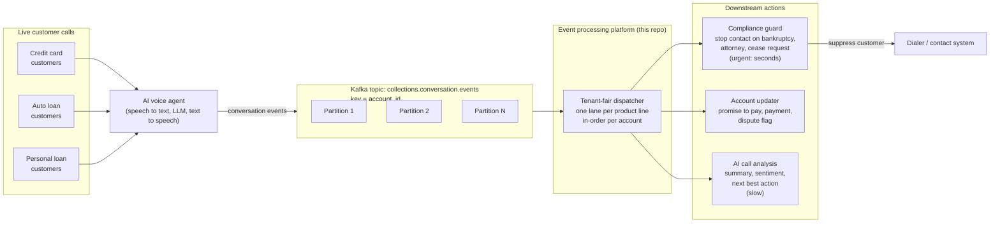
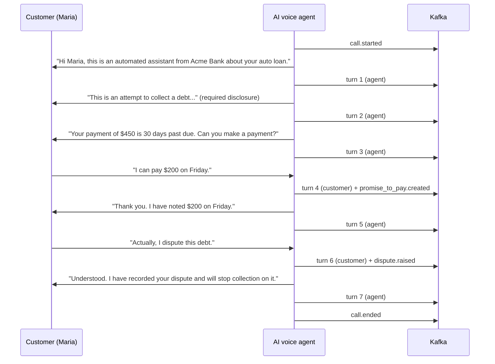
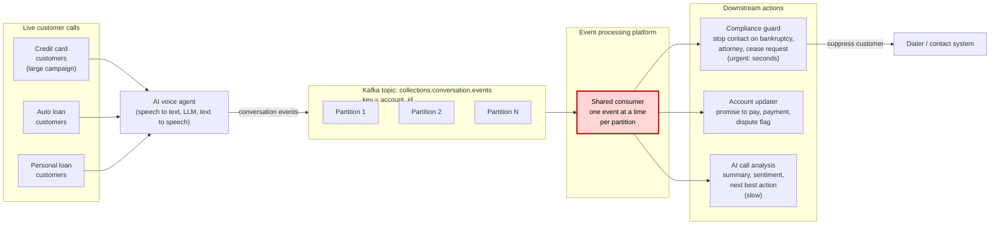
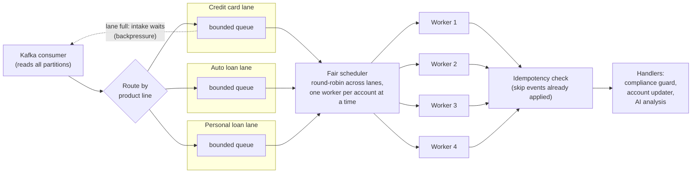

# Problem statement: tenant-fair event processing for an AI debt-recovery voice agent

> Draft for review. This document describes the problem and the target design.
> The code in this repo is still being reworked to match it.

## 1. Context

A US bank uses an **AI voice agent** to talk to customers about overdue balances
(debt recovery / collections). The agent only calls customers whose accounts are
**past due** (in collections); it never contacts customers who are current. One shared platform serves several **product lines**:

| Product line (tenant) | Typical traffic |
|---|---|
| Credit cards | Very high volume, large outbound calling campaigns |
| Auto loans | Medium volume |
| Personal loans | Low volume |

While the agent talks to a customer, the call produces **events** (what was said,
what the customer intends, promises to pay, payments). These events go to **Kafka**
so that other systems can react to them in near real time.

### What is a "tenant" here?

A **tenant** is a group that **shares a system** with other groups but must be
**treated separately**, like apartments in one building. Here the shared system is
the event pipeline, and the tenants are the product lines. Because all product lines
flow through the same pipeline, the system is **multi-tenant**.

## 2. High-level architecture

Note: the live conversation itself (speech in, AI reply out) does **not** go through
Kafka. Kafka carries **what happened in the call** to the systems that must act on it.

### Example: one call and the events it sends to Kafka

Maria is called **only because her auto loan payment is 30 days past due** (she is in
collections). Customers who are not in collections are never called.

**Every turn of the conversation**, from the agent and from the customer, is published
to Kafka as a `conversation.turn` event. When the AI recognises a business intent in a
turn (a promise to pay, a dispute), it also publishes a **business event** for it.

## 3. Problem statement

**Context.** The bank runs one AI collections agent per loan product: credit card, auto
loan and personal loan. Each agent calls **its own past-due customers**. All three
publish every conversation turn to **one shared Kafka topic**, keyed by account ID. The
topic is shared because this is one platform: the same event format and the same
downstream services (compliance, account updates, AI analysis). Each customer's events
must be processed in order.

**What goes wrong.** The consumer processes each partition **one event at a time**. When
one product runs a large campaign, its events fill every partition, and **urgent events
from the other products wait behind them**.

*Credit card campaign traffic fills the red box; auto loan and personal loan events wait
there.*

**Evidence.** Measured in this repo with `make demo`. It is a scaled-down test: 2,000
events, 70% from the credit card campaign. Credit card events arrive as one burst; auto
loan and personal loan events keep arriving steadily over 4 seconds.

| Product | p99 wait: one shared consumer | p99 wait: tenant-fair dispatch |
|---|---|---|
| Credit card (busy campaign) | 4.7 s | 1.3 s |
| Auto loan | **4.7 s** | **13 ms** |
| Personal loan | **4.7 s** | **13 ms** |

The credit card campaign slows the other products down **about 350 times**. With
tenant-fair dispatch, only credit card events wait for credit card traffic.

**Impact.** An auto loan customer says *"stop calling me"*. The "do not contact" flag is
set only after the credit card backlog clears. Meanwhile, the auto loan dialer's next
scheduled attempt **calls the customer again**, which is a compliance violation. The auto
loan team did nothing wrong; another product's traffic caused it.

**Any fix must keep:**

1. Each customer's events processed in order.
2. Each event applied only once, even if Kafka delivers it twice.
3. Memory bounded when one product floods the platform.

## 4. Target design

| Requirement | How the design meets it |
|---|---|
| One product line cannot delay another | Separate lane per product line + round-robin scheduler |
| Each customer's events stay in order | Only one worker handles a given account at a time |
| A hot product line cannot exhaust memory | Bounded lane; when it is full, intake waits until it drains (backpressure) |
| No duplicate promises or payments | Idempotency check on `event_id`, recorded only **after** successful processing |
| A bad event does not stop the platform | Retry a few times, then move to a dead-letter queue |

## 5. What the demo and tests prove

`make demo` runs the same burst through three strategies:

| Strategy | Auto loan p99 | Personal loan p99 | Ordering errors |
|---|---|---|---|
| Sequential (one shared consumer) | 4.7 s | 4.7 s | 0 |
| Unordered pool ("just add workers") | 1.1 s | 1.2 s | **126** |
| **Tenant-fair** | **13 ms** | **13 ms** | **0** |

`make test` checks the remaining guarantees:

| Scenario | Result |
|---|---|
| Same event delivered twice | Applied once (idempotency check) |
| One event keeps failing | Retried, then dead-lettered; the other events keep flowing |
| Bug inside processing | Worker survives; event is dead-lettered |
| Lane full | Intake waits, nothing is lost |
| One account | Never processed by two workers at once; other accounts run in parallel |

## 6. Out of scope for this proof of concept

- The voice agent itself (speech recognition, LLM, telephony) is simulated.
- Storage is in memory; production would use a database and Redis for idempotency keys.
- Legal rules are simplified to "suppress contact on bankruptcy, attorney or cease request".
