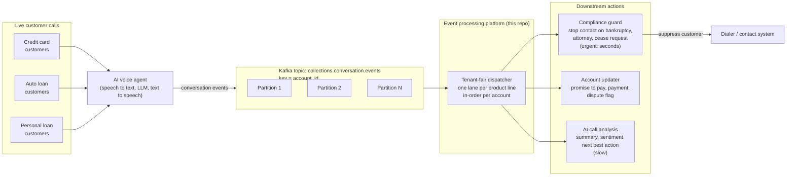
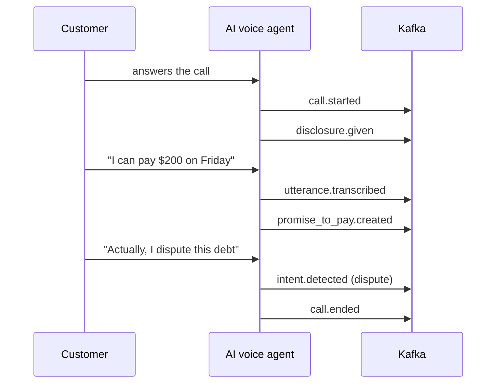
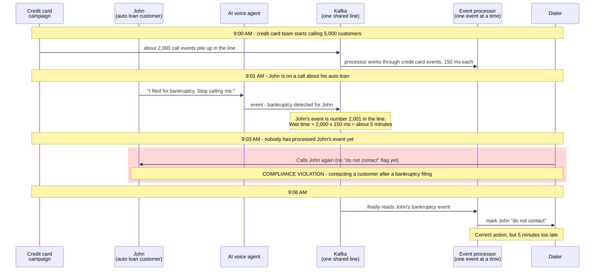
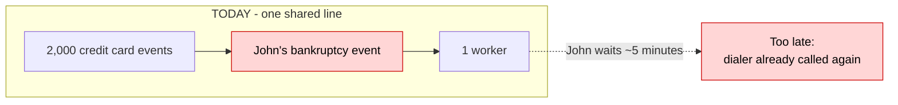
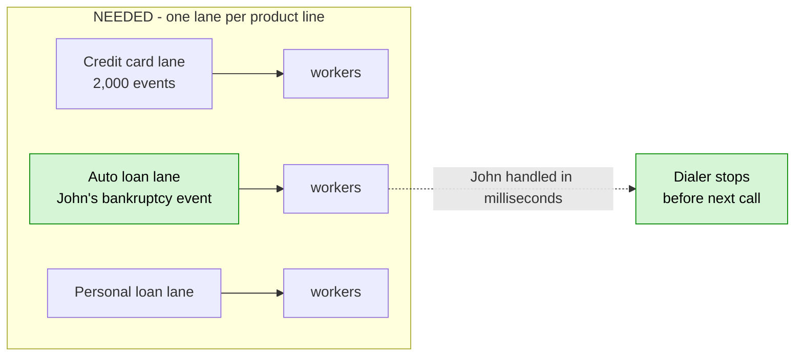
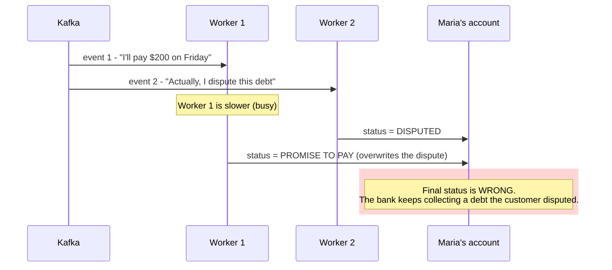
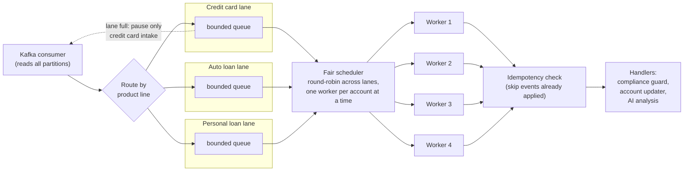

# Problem statement: tenant-fair event processing for an AI debt-recovery voice agent

> Draft for review. This document describes the problem and the target design.
> The code in this repo is still being reworked to match it.

## 1. Context

A US bank uses an **AI voice agent** to talk to customers about overdue balances
(debt recovery / collections). One shared platform serves several **product lines**:

| Product line (tenant) | Typical traffic |
|---|---|
| Credit cards | Very high volume, large outbound calling campaigns |
| Auto loans | Medium volume |
| Personal loans | Low volume |

While the agent talks to a customer, the call produces **events** (what was said,
what the customer intends, promises to pay, payments). These events go to **Kafka**
so that other systems can react to them in near real time.

### What is a "tenant" here?

A **tenant** is a group that **shares a system** with other groups but must be
**treated separately**, like apartments in one building. Here the shared system is
the event pipeline, and the tenants are the product lines. Because all product lines
flow through the same pipeline, the system is **multi-tenant**.

## 2. High-level architecture

Note: the live conversation itself (speech in, AI reply out) does **not** go through
Kafka. Kafka carries **what happened in the call** to the systems that must act on it.

### Example events from one call

## 3. The problem

### 3.1 What goes wrong: a 6-minute story

**Setup today:** all product lines share the same Kafka topic. The consumer reads
each partition **one event at a time, in arrival order** (that is how Kafka keeps
order). Each event takes about **150 ms**, because AI analysis runs on every event.

Follow one auto loan customer, **John**, through a Monday morning:

**The auto loan team did nothing wrong.** The credit card team's traffic caused the
delay, and the auto loan team pays the price. This is the **noisy-neighbor problem**:
in a shared system, one tenant's load hurts another tenant.

### 3.2 Why it happens

Three things together cause it:

1. **All product lines share one line** (the same Kafka partitions).
2. **The line is processed one event at a time** (to keep events in order).
3. **One product line sends far more events** than the others (a calling campaign).

So an urgent event from a small product line waits behind a big product line's backlog.

### 3.3 Why "just add more workers" breaks something else

If we simply let many workers process events in parallel, **one customer's events can
finish out of order**. Follow customer **Maria**, who says two things on one call:

So we need **both**: parallel lanes so product lines do not block each other, **and**
a guarantee that **each customer's events are processed in order**.

### 3.4 Problem statement

> Several product lines share one event pipeline.
>
> 1. **Isolation:** one product line's traffic must not delay another product line's urgent events (John).
> 2. **Ordering:** each customer's events must be processed in the exact order they happened (Maria).
> 3. **No duplicates:** an event delivered twice must be applied only once (no double payment plans).

## 4. Target design

| Requirement | How the design meets it |
|---|---|
| One product line cannot delay another | Separate lane per product line + round-robin scheduler |
| Each customer's events stay in order | Only one worker handles a given account at a time |
| A hot product line cannot exhaust memory | Bounded lane; when full, only that product line's intake pauses (backpressure) |
| No duplicate promises or payments | Idempotency check on `event_id`, recorded only **after** successful processing |
| A bad event does not stop the platform | Retry a few times, then move to a dead-letter queue |

## 5. What the demo will prove

| Scenario | Naive (one shared line) | Tenant-fair design |
|---|---|---|
| Credit card campaign burst | Auto loan bankruptcy event waits minutes | Handled in milliseconds |
| Customer events out of order | Not applicable (single thread) | Zero ordering violations |
| Same event delivered twice | Applied twice | Applied once |
| One event keeps failing | Pipeline stalls | Event goes to dead-letter queue, others continue |

## 6. Out of scope for this proof of concept

- The voice agent itself (speech recognition, LLM, telephony) is simulated.
- Storage is in memory; production would use a database and Redis for idempotency keys.
- Legal rules are simplified to "suppress contact on bankruptcy, attorney or cease request".
