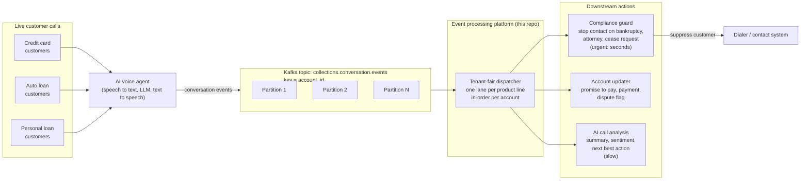
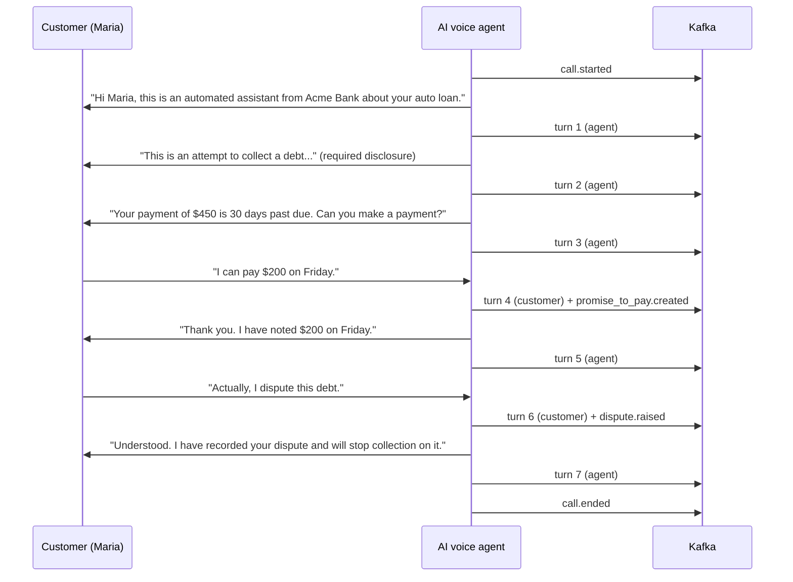
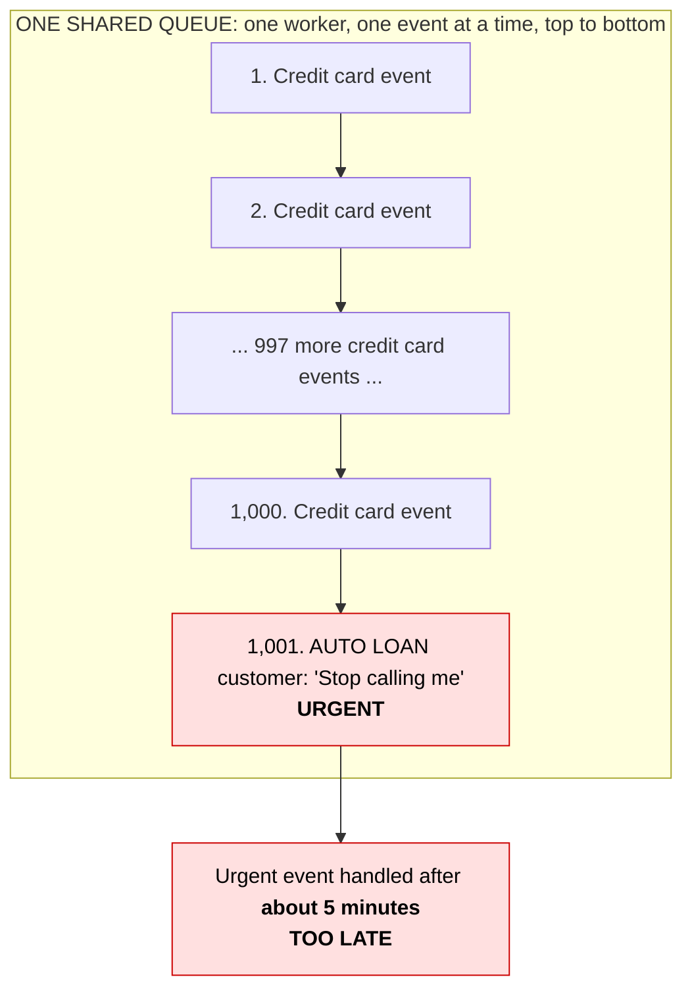
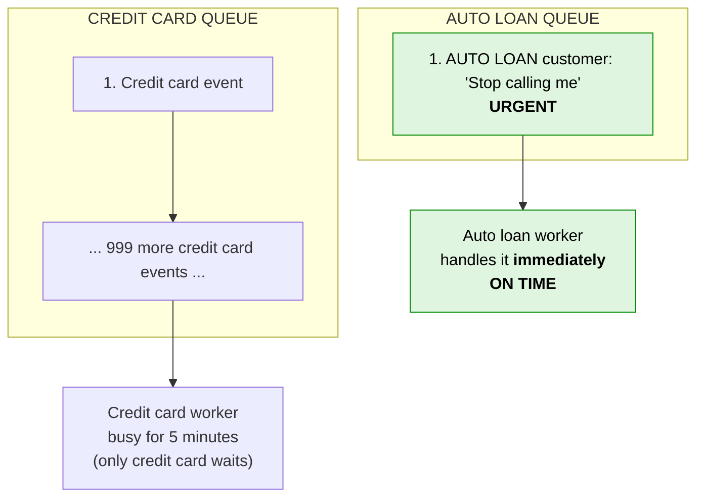
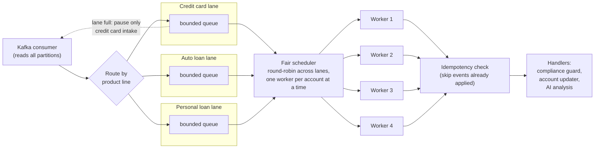

# Problem statement: tenant-fair event processing for an AI debt-recovery voice agent

> Draft for review. This document describes the problem and the target design.
> The code in this repo is still being reworked to match it.

## 1. Context

A US bank uses an **AI voice agent** to talk to customers about overdue balances
(debt recovery / collections). The agent only calls customers whose accounts are
**past due** (in collections); it never contacts customers who are current. One shared platform serves several **product lines**:

| Product line (tenant) | Typical traffic |
|---|---|
| Credit cards | Very high volume, large outbound calling campaigns |
| Auto loans | Medium volume |
| Personal loans | Low volume |

While the agent talks to a customer, the call produces **events** (what was said,
what the customer intends, promises to pay, payments). These events go to **Kafka**
so that other systems can react to them in near real time.

### What is a "tenant" here?

A **tenant** is a group that **shares a system** with other groups but must be
**treated separately**, like apartments in one building. Here the shared system is
the event pipeline, and the tenants are the product lines. Because all product lines
flow through the same pipeline, the system is **multi-tenant**.

## 2. High-level architecture

Note: the live conversation itself (speech in, AI reply out) does **not** go through
Kafka. Kafka carries **what happened in the call** to the systems that must act on it.

### Example: one call and the events it sends to Kafka

Maria is called **only because her auto loan payment is 30 days past due** (she is in
collections). Customers who are not in collections are never called.

**Every turn of the conversation**, from the agent and from the customer, is published
to Kafka as a `conversation.turn` event. When the AI recognises a business intent in a
turn (a promise to pay, a dispute), it also publishes a **business event** for it.

## 3. The problem

### 3.1 The story in four steps

1. **9:00 AM** The credit card team starts a campaign that calls 5,000 customers.
   Their calls send **thousands of events** into Kafka.
2. **9:01 AM** On a different call, auto loan customer **John** says:
   *"I filed for bankruptcy. Stop calling me."* The agent sends that event to Kafka.
3. Kafka hands events to the processor **one at a time, in arrival order**.
   John's event is **behind 2,000 credit card events**. At 150 ms each, it waits
   **about 5 minutes**.
4. **9:03 AM** The dialer does not know about the bankruptcy yet, so it **calls John
   again**. Contacting a customer after a bankruptcy filing is a **compliance violation**.

**The auto loan team did nothing wrong.** Another product line's traffic delayed its
urgent event. This is the **noisy-neighbor problem**: in a shared system, one tenant's
load hurts another tenant.

### 3.2 Picture: the problem (one shared queue)

All product lines put their events in **one queue**, handled **one at a time, first come,
first served**.

**Problem:** the auto loan event is urgent, but it waits behind 1,000 credit card events.

### 3.3 Picture: the fix (one queue per product line)

Each product line gets **its own queue and its own worker**.

**Fix:** a busy product line only slows down itself. Urgent events from other product
lines are never stuck behind it.

### 3.4 Why we cannot simply add more workers to the shared line

More workers in parallel would remove the wait, but **one customer's events could
finish in the wrong order**. Customer **Maria** says two things on one call:

| Step | What Maria said | Event | With random parallel workers |
|---|---|---|---|
| 1 | "I can pay $200 on Friday." | `promise_to_pay.created` | Worker 1 picks it up but is slow |
| 2 | "Actually, I dispute this debt." | `dispute.raised` | Worker 2 finishes first: account = **DISPUTED** |
| 3 | | | Worker 1 finishes last: account = **PROMISE TO PAY** (overwrites the dispute) |

**Result:** the account says "promise to pay" and the bank keeps collecting a debt the
customer disputed. Maria's events must be processed **in the order she said them**.

### 3.5 Problem statement

> Several product lines share one event pipeline. The platform must guarantee:
>
> 1. **Isolation:** one product line's traffic never delays another product line's urgent events (John).
> 2. **Ordering:** each customer's events are processed in the order they happened (Maria).
> 3. **No duplicates:** an event delivered twice is applied only once (no double payment plans).

## 4. Target design

| Requirement | How the design meets it |
|---|---|
| One product line cannot delay another | Separate lane per product line + round-robin scheduler |
| Each customer's events stay in order | Only one worker handles a given account at a time |
| A hot product line cannot exhaust memory | Bounded lane; when full, only that product line's intake pauses (backpressure) |
| No duplicate promises or payments | Idempotency check on `event_id`, recorded only **after** successful processing |
| A bad event does not stop the platform | Retry a few times, then move to a dead-letter queue |

## 5. What the demo will prove

| Scenario | Naive (one shared line) | Tenant-fair design |
|---|---|---|
| Credit card campaign burst | Auto loan bankruptcy event waits minutes | Handled in milliseconds |
| Customer events out of order | Not applicable (single thread) | Zero ordering violations |
| Same event delivered twice | Applied twice | Applied once |
| One event keeps failing | Pipeline stalls | Event goes to dead-letter queue, others continue |

## 6. Out of scope for this proof of concept

- The voice agent itself (speech recognition, LLM, telephony) is simulated.
- Storage is in memory; production would use a database and Redis for idempotency keys.
- Legal rules are simplified to "suppress contact on bankruptcy, attorney or cease request".
