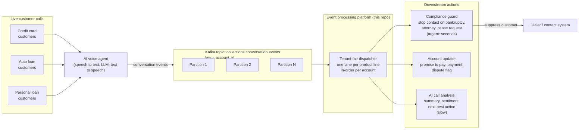
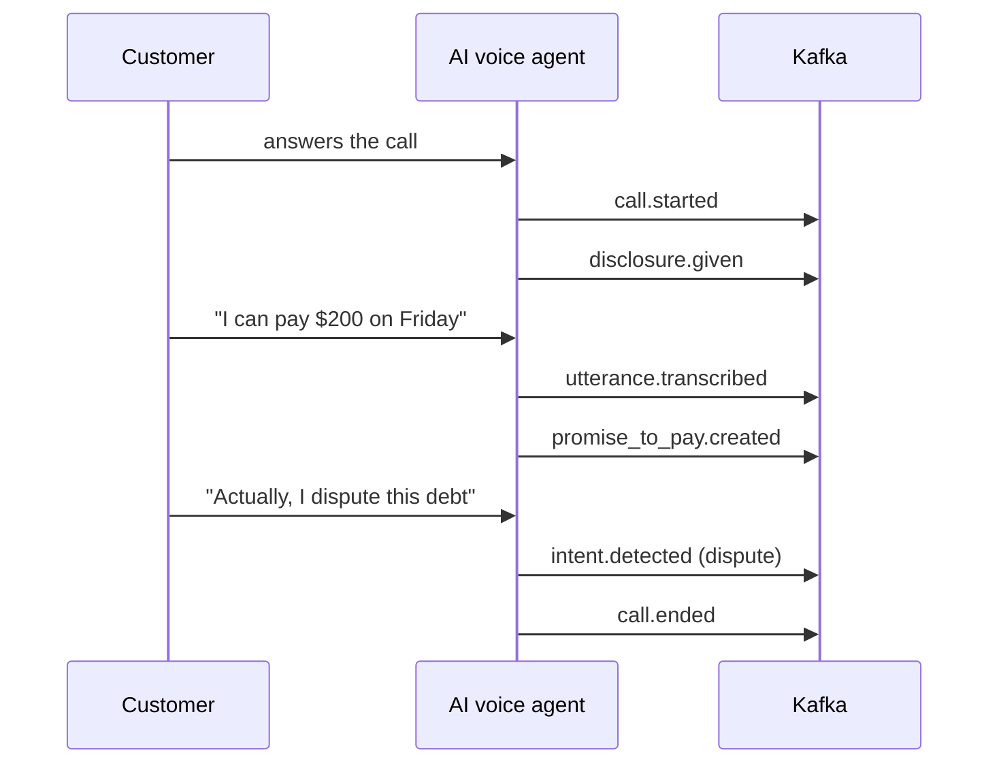
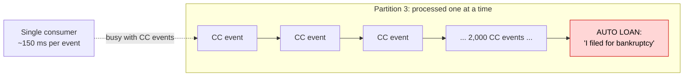
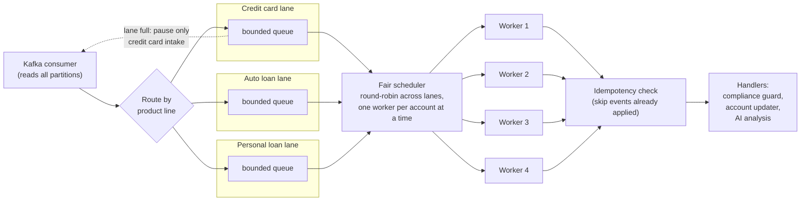

# Problem statement: tenant-fair event processing for an AI debt-recovery voice agent

> Draft for review. This document describes the problem and the target design.
> The code in this repo is still being reworked to match it.

## 1. Context

A US bank uses an **AI voice agent** to talk to customers about overdue balances
(debt recovery / collections). One shared platform serves several **product lines**:

| Product line (tenant) | Typical traffic |
|---|---|
| Credit cards | Very high volume, large outbound calling campaigns |
| Auto loans | Medium volume |
| Personal loans | Low volume |

While the agent talks to a customer, the call produces **events** (what was said,
what the customer intends, promises to pay, payments). These events go to **Kafka**
so that other systems can react to them in near real time.

### What is a "tenant" here?

A **tenant** is a group that **shares a system** with other groups but must be
**treated separately**, like apartments in one building. Here the shared system is
the event pipeline, and the tenants are the product lines. Because all product lines
flow through the same pipeline, the system is **multi-tenant**.

## 2. High-level architecture

Note: the live conversation itself (speech in, AI reply out) does **not** go through
Kafka. Kafka carries **what happened in the call** to the systems that must act on it.

### Example events from one call

## 3. The problem

### 3.1 Noisy neighbor: one product line delays another

Monday 9am: the credit card team starts a campaign that calls 5,000 customers. Every
call produces dozens of events, and each one goes through slow AI analysis.

A standard Kafka consumer processes each partition **one event at a time**, and every
partition holds events from **all** product lines mixed together:

2,000 events x 150 ms = **about 5 minutes** before the bankruptcy event is even read.
In that time the dialer still has no "do not contact" flag and **calls the customer
again**. Contacting a customer after a bankruptcy filing is a **regulatory violation**.

The auto loan team did nothing wrong. The credit card team's traffic caused the delay.
This is the **noisy-neighbor problem**.

### 3.2 Why "just process in parallel" is not enough

Parallel processing removes the waiting, but it can **reorder one customer's events**:

| Real order | Processed out of order | Result |
|---|---|---|
| 1. "I'll pay $200 Friday" 2. "I dispute this debt" | dispute first, then promise | Account shows **promise to pay** while the customer is **disputing**; the bank may chase a disputed debt |

So each customer's (account's) events **must stay in order**.

### 3.3 Problem statement (one sentence)

> Several product lines share one event pipeline. **One product line's traffic must
> not delay another product line's urgent events**, while **each customer's events are
> still processed in the exact order they happened**, and **no event is applied twice**.

## 4. Target design

| Requirement | How the design meets it |
|---|---|
| One product line cannot delay another | Separate lane per product line + round-robin scheduler |
| Each customer's events stay in order | Only one worker handles a given account at a time |
| A hot product line cannot exhaust memory | Bounded lane; when full, only that product line's intake pauses (backpressure) |
| No duplicate promises or payments | Idempotency check on `event_id`, recorded only **after** successful processing |
| A bad event does not stop the platform | Retry a few times, then move to a dead-letter queue |

## 5. What the demo will prove

| Scenario | Naive (one shared line) | Tenant-fair design |
|---|---|---|
| Credit card campaign burst | Auto loan bankruptcy event waits minutes | Handled in milliseconds |
| Customer events out of order | Not applicable (single thread) | Zero ordering violations |
| Same event delivered twice | Applied twice | Applied once |
| One event keeps failing | Pipeline stalls | Event goes to dead-letter queue, others continue |

## 6. Out of scope for this proof of concept

- The voice agent itself (speech recognition, LLM, telephony) is simulated.
- Storage is in memory; production would use a database and Redis for idempotency keys.
- Legal rules are simplified to "suppress contact on bankruptcy, attorney or cease request".
