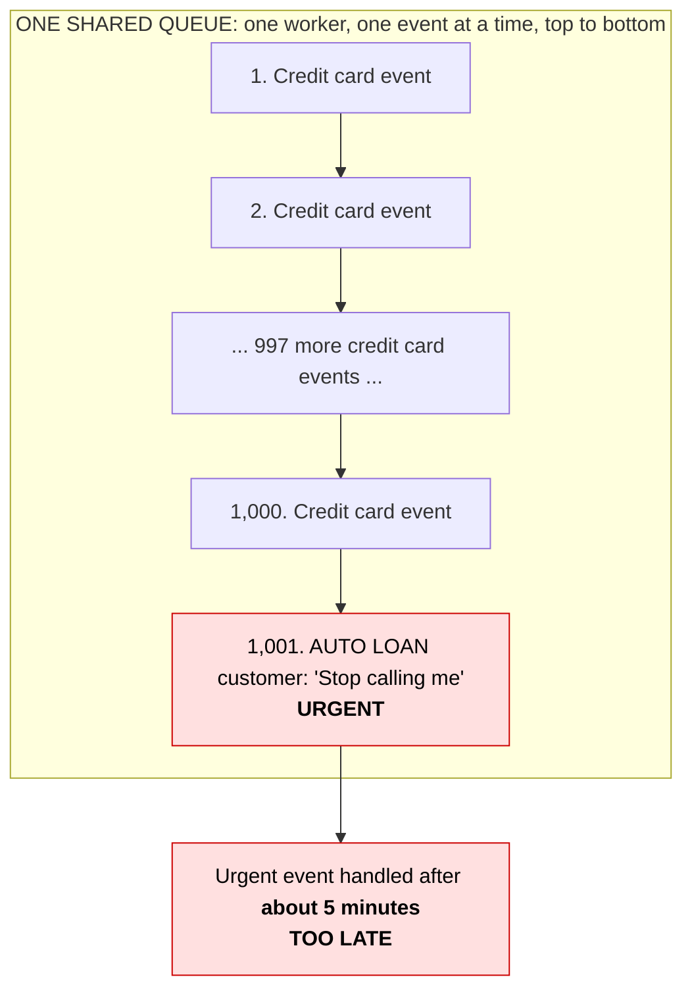
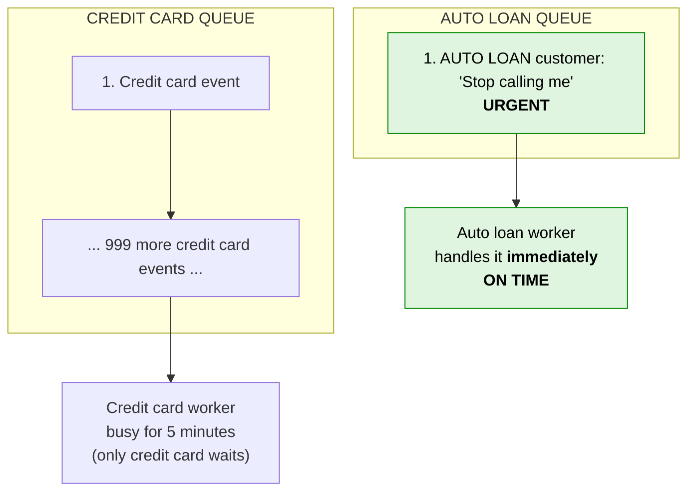

# The problem in two pictures

## Picture 1: the problem (one shared queue)

All products put their events in **one queue**. One worker takes them **one at a time,
first come, first served**.

**Problem:** the auto loan event is urgent, but it waits behind 1,000 credit card events.

## Picture 2: the fix (one queue per product)

Each product gets **its own queue and its own worker**.

**Fix:** a busy product only slows down itself. Urgent events from other products are
never stuck behind it.
